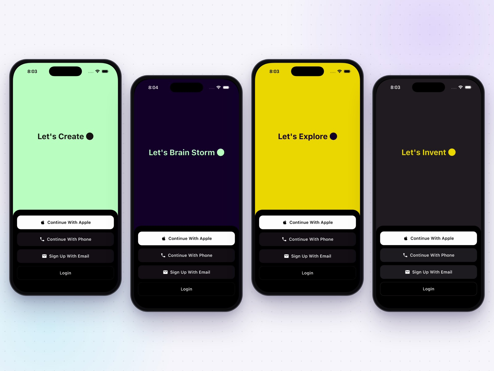

# AI Onboarding Animation in Flutter

An animated onboarding screen for an AI app, built in Flutter. The headline types itself out
("Let's Create", "Let's Brain Storm", "Let's Explore", "Let's Invent") with a round cursor, then
deletes itself while the background changes colour. A sign-in sheet with Apple, Phone, Email and
Login buttons slides up from the bottom.

🌐 **Live demo:** https://yaqoobdeveloper.github.io/AI-Onboarding-Animation-in-Flutter/

🔒 **Full source code:** available to members of the Flutter Source Club: https://yaqoobdeveloper.com/pro

📺 **YouTube Short:** https://youtube.com/shorts/7u2kTFGR7YU

📺 **More Flutter UI:** https://www.youtube.com/@yaqoob_developer

This repository only hosts the live demo. It does not contain the source code.
